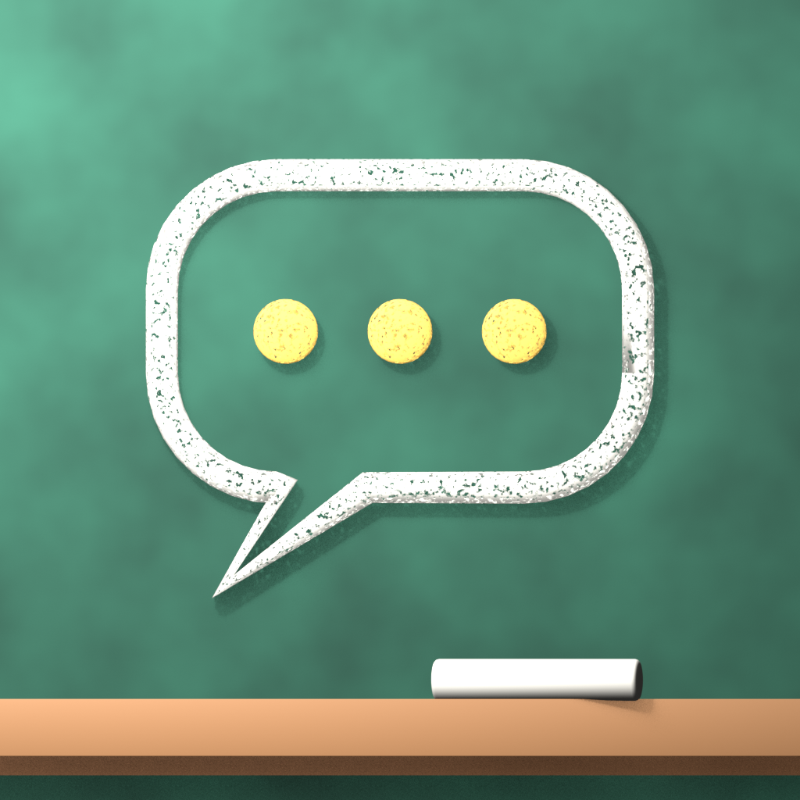
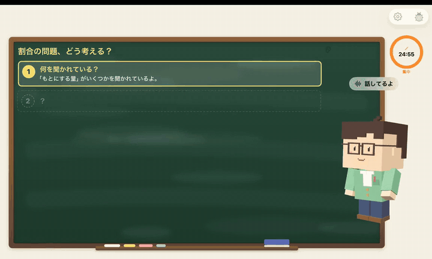
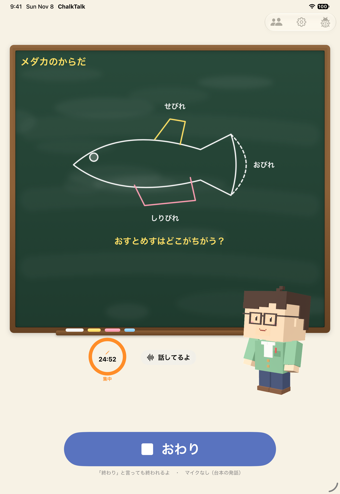
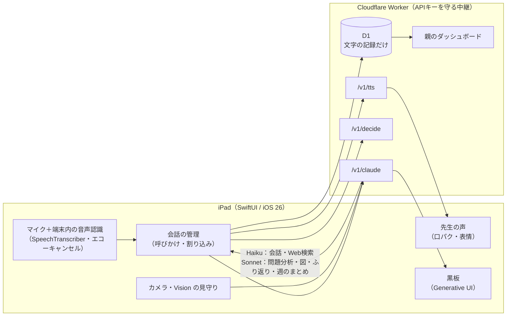

<div align="center">



# ChalkTalk

**話しかければ、そばに先生。**

一人で勉強する子どものそばにいる、声で話せる iPad の先生。<br>
わからないところは、**答えを言わずに、ヒントと黒板の図で**導きます。

[](https://cerebralvalley.ai/events/~/e/built-with-claude-japan2026)




▶️ **[デモ動画（2分53秒）を見る](docs/demo/demo.mp4)**

</div>

---

## なぜ作ったか

共働きのわが家。小5の長男は受検勉強をしています。勉強に使える時間はあるのに、**その時間に親は仕事と家事で見てあげられない**。一人で机に向かうのは孤独です。

家庭教師は、費用と時間に余裕のある家庭にしか届きません。ChalkTalk は、答えを教えるのではなく「一緒に考える」伴走を、どの家庭にも届けるためのアプリです。

> 判断に迷ったら「これで孤独は減るか？」「本物の家庭教師ならどうするか？」で決めています。

## できること

### 🎙️ 声だけで話せる

キーボードは使いません。「ねえ先生」と話しかけ、先生が話している途中でも「待って」と割り込めます。割り込まれたら読み上げと Claude のストリームをすぐ止め、**実際に話したところまで**会話の履歴を切り詰めます。

### 📷 「これ見て」で問題を見せる → 答えは言わない

iPad のカメラで問題を撮ると、Claude が読み取り、

**何を聞かれている？ → どこを見る？ → 考え方 → 一緒にたどる**

の段階でヒントを出します。最後のひと言は子どもに言わせます。正答は「先生のメモ」に隠し、話す前に `AnswerLeakGuard` が正答の漏れ（全角半角・漢数字・分数・単位の言い換えまで）を検査します。

### 🧑‍🏫 黒板に図を描く（Generative UI）

撮った問題でも、会話の途中の「もとにする量ってなに？」でも、先生が黒板に図を出します。手順カード・線分図・面積図・数直線・割合の帯図・ベン図・時間の流れ・表・グラフ……に加えて、線・図形・SVG パスで**自由な形**も描けます。話に合わせて1つずつ見せ、答えの部分は「？」のまま。

<p align="center">


</p>

必要なら Web で調べて答えたり（`web_search`）、ウィキペディアの自由ライセンスの写真を黒板に出したりもします。

### 🧸 8人から選べる、そばにいる先生

ボクセル、ふわふわの動物、切り絵、チョークの線画まで、見た目・声・性格のそろったオリジナルのキャラから選べます。うなずき・考え中・ほめる・励ますの表情と、声に合わせた口の動き。待機中のちょっとした癖や、触ったときの反応もあります。

<p align="center">

</p>

<details>
<summary>全員の「ふだん」と「ほめる」の表情を見る</summary>
<p align="center"></p>
</details>

### ⏱️ 時間の声かけと、覚えていること

- 集中25分＋休憩5分。休憩中は雑談もできる。「休憩したい」「今日はここまで」も声で
- 手が止まっていたら、端末内の Vision で気づいて「どこか考え中？ちょっと見せて？」
- 前回の内容や好きなことを覚えていて「昨日の割合の続きやる？」と始め、終わりにはその日のがんばりを具体的にほめる

### 👨‍👩‍👦 親はスマホで見守る


- **今夜の声かけ**：「『もとにする量をどうやって見つけたの？』と聞いてみてください」
- **要確認**：深刻な悩みの兆しは親に残る
- 日ごとの学習時間、取り組んだ問題、自力で解けた問題の変化
- **週のまとめ**：伸びたことと来週の見どころ（Sonnet）
- **親の伝言**：書いた言葉を、次の勉強の始まりに先生が伝える
- **先生が覚えていること**を確認して、1件ずつ消せる

**写真と音声はどこにも保存しません。** 残すのは文字の要約だけです。

<br clear="right">

## しくみ



| 役割 | 使うもの |
| --- | --- |
| 会話 | `claude-haiku-5-5`（文ごとにストリーミングして読み上げ。プロンプトキャッシュ。実機で最初の一文まで約1秒） |
| 問題の読み取り・ヒント・図・ふり返り・週のまとめ | `claude-sonnet-5-5`（tool use で型の決まった出力） |
| 速い判断（話しかけたか・言い終わったか・撮影/休憩/終わりたいか・答えの正誤） | TypeSafe AI の Jev（Decision API、6問まとめて約170ms。使えないときは規則で判断） |
| 読み上げ | Azure Neural TTS（キャラごとの声）／ ElevenLabs に切り替え可。使えないときは端末の声 |
| サーバー | Cloudflare Workers ＋ D1、Google ログイン |

### 実機で測った数字

| | |
| --- | --- |
| **約1秒** | 話し終えてから先生の最初の一文まで（iPad 実機） |
| **0/10 → 10/10** | オリジナルの10問で図が出た問題（改善前 → 改善後。図に答えが書かれたのは 0/10）［[記録](docs/boards-eval.md)］ |
| **34% → 0%** | 先生の声が音声認識に混ざる割合（エコーキャンセルなし → あり） |

## 動かす


Worker・D1・Google ログイン・TTS を自分で用意する手順は [docs/setup.md](docs/setup.md) にあります。

```bash
# Worker
cd worker && npm install && npm test && npm run typecheck

# iOS のテスト
cd ios && xcodegen generate && xcodebuild test -project HomeTeacher.xcodeproj -scheme HomeTeacher \
  -destination 'platform=iOS Simulator,name=iPad Pro 11-inch (M5)'

# プロンプトの判定ロジック（API 不要）
node --test evals/*.test.mjs
```

## リポジトリの中身

| ディレクトリ | 中身 |
| --- | --- |
| `ios/` | iPad アプリ（SwiftUI・RealityKit・Speech・AVAudioEngine・Vision）。`project.yml` が正 |
| `worker/` | Cloudflare Worker（Claude・TTS・Jev の中継、D1、親のダッシュボード） |
| `prompts/` | アプリに同梱する会話のプロンプトとキャラごとの性格（`characters/`） |
| `evals/` | 本番の Claude に対するプロンプトの評価 |
| `avatar/` | キャラの 3D モデルを作る Blender のスクリプト |
| `docs/` | 仕様・ビジョン・評価の記録・スクリーンショット |

開発は Claude Code で、仕様書と GitHub issue を作り、issue ごとに worktree を切って実装 → テスト → PR → マージを回しました。

## ドキュメント

- [提出用の概要](docs/submission.md)
- [仕様書](docs/spec.md) ／ [ビジョンと決定事項](docs/vision.md)
- [セットアップ手順](docs/setup.md)
- [黒板の図の評価](docs/boards-eval.md)
- [デモ動画の台本](docs/demo-script.md) ／ [技術調査](docs/research-2026-11-03.md) ／ [ハッカソン要項](docs/hackathon-guide.md)

## ライセンス

[MIT](LICENSE)
